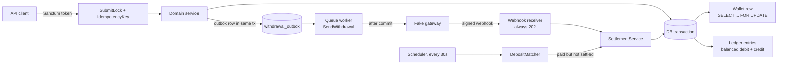

# laravel-wallet-ledger

A Laravel wallet and double-entry ledger that moves money exactly once, under concurrency, with tests that prove it.

[](https://github.com/prothomacharjee/laravel-wallet-ledger/actions/workflows/ci.yml)


[](LICENSE)

## Why this exists

I build fintech backends in production: wallets, ledgers, deposits and withdrawals for a production fintech platform I work on (private). That code belongs to my employer and cannot be shared. This repository shows the same patterns, written from scratch, against fake payment gateways, with tests you can run.

## Guarantees

| Guarantee | How | Proven by |
|---|---|---|
| No double spend | Balance checks run on the wallet row after `SELECT ... FOR UPDATE`, in the same transaction as the debit. `wallets.balance` is `UNSIGNED` as a last backstop. | [`ParallelSpendingTest`](tests/Concurrency/ParallelSpendingTest.php): 50 real OS processes withdraw from a wallet funded for 10. Exactly 10 succeed, the balance ends at zero. |
| Transfers do not deadlock each other | Wallets are always locked lowest ID first. Deadlocks from other paths are retried a fixed 3 times. | [`TransferServiceTest`](tests/Integration/Transfer/TransferServiceTest.php) records the locking queries and asserts the order. `wallet:stress` output below: 0 deadlocks in 1,000 concurrent transfers. |
| The ledger always balances | Every movement writes a debit and a credit of the same amount in one transaction with the wallet change. Entries are append-only (model guard and MySQL triggers). `ledger:verify` checks it. | [`LedgerWriterTest`](tests/Integration/Ledger/LedgerWriterTest.php), [`LedgerEntryImmutabilityTest`](tests/Integration/Ledger/LedgerEntryImmutabilityTest.php), [`LedgerVerifyCommandTest`](tests/Feature/LedgerVerifyCommandTest.php) |
| A webhook credits once | HMAC-SHA256 checked with `hash_equals`. Settlement locks the deposit, and unique keys on the provider transaction ID and on the ledger posting stop a second credit. | [`WebhookTest`](tests/Feature/Api/WebhookTest.php): the same webhook delivered five times credits once. |
| A missed webhook still settles | A scheduled matcher runs every 30 seconds and settles paid deposits through the same idempotent path. | [`DepositMatcherTest`](tests/Integration/Deposit/DepositMatcherTest.php) |
| A failed gateway call never loses money | In-transaction withdrawal: a refusal rolls back the debit, and an accepted payout whose commit fails is cancelled upstream. Outbox withdrawal: a refusal refunds the wallet with a reversing ledger entry. | [`WithdrawalServiceTest`](tests/Integration/Withdrawal/WithdrawalServiceTest.php), [`OutboxWithdrawalServiceTest`](tests/Integration/Withdrawal/OutboxWithdrawalServiceTest.php) |
| A retried request is not applied twice | `Idempotency-Key` header: same key and body replays the stored response, a different body gets `422`. A Redis submit lock rejects a double click before it reaches the database. | [`IdempotencyKeyTest`](tests/Feature/Api/IdempotencyKeyTest.php), [`TransferEndpointTest`](tests/Feature/Api/TransferEndpointTest.php) |
| Deposits never exceed the balance cap | The cap is checked under the wallet lock, before any money moves. | [`DepositEndpointTest`](tests/Feature/Api/DepositEndpointTest.php), [`WalletServiceTest`](tests/Integration/Wallet/WalletServiceTest.php) |
| Partner commission is paid exactly once and never above the top rate | A sub-partner's rate is at least 5 points below its parent's, and both shares are cut from one rounded-down total. Rows are paid in batches of 500 with a savepoint per row; the row is marked paid in the same savepoint as its wallet credits. | [`CommissionTest`](tests/Integration/Commission/CommissionTest.php) |
| Withdrawals respect daily and monthly limits | Limits are summed under the wallet lock, so parallel requests cannot both slip under. | [`WithdrawalLimitsTest`](tests/Integration/Withdrawal/WithdrawalLimitsTest.php) |

All tests run against real MySQL 8 and Redis, never SQLite ([`HealthCheckTest`](tests/Feature/HealthCheckTest.php) fails if they do not).

## Architecture



The code lives in `app/Domain`, one folder per concept: `Money`, `Wallet`, `Ledger`, `Transfer`, `Deposit`, `Withdrawal`, `Gateway`, `Commission`. Controllers in `app/Http/Controllers/Api` validate input and call one service. Services own the transaction. Amounts move through the code only as the `Money` value object.

## Quick start

Requires Docker.

```bash
git clone https://github.com/prothomacharjee/laravel-wallet-ledger.git
cd laravel-wallet-ledger
cp .env.example .env
docker compose up -d
docker compose exec app php artisan key:generate
docker compose exec app php artisan migrate --seed
docker compose exec app php artisan test
```

This starts the API on `http://localhost:8000`, a queue worker, the scheduler (deposit matcher, outbox relay and commission payer), MySQL 8 and Redis 7. The seeder creates `demo1@example.com` to `demo20@example.com` (password `password`), each with a USD wallet holding 500.00.

CI runs the same steps on every push: Pint, Larastan and the full suite against MySQL 8 and Redis 7 service containers.

## Try it

Get a token for a demo user:

```bash
TOKEN=$(docker compose exec -T app php artisan tinker --execute="echo App\Models\User::where('email','demo1@example.com')->first()->createToken('demo')->plainTextToken;")
```

Create a deposit. It stays pending until the gateway says it was paid:

```bash
curl -X POST http://localhost:8000/api/deposits \
  -H "Authorization: Bearer $TOKEN" -H "Accept: application/json" -H "Content-Type: application/json" \
  -d '{"gateway":"fake-fiat","currency":"USD","amount":"25.00"}'
# {"reference":"6531cc4e-d355-4eb5-9f0d-02cd0a35131d","gateway":"fake-fiat","status":"pending","amount":"25.00","currency":"USD"}
```

Mark it paid at the fake gateway. The command prints the signed webhook to send:

```bash
docker compose exec app php artisan gateway:simulate-payment 6531cc4e-d355-4eb5-9f0d-02cd0a35131d
# curl -X POST http://localhost:8000/api/webhooks/fake-fiat \
#   -H "Content-Type: application/json" \
#   -H "X-Signature: ba6c57c97c571fe6ed90154ee55be81c62ecd30da77e18cdfb16153c2854f8d8" \
#   -d '{"event":"payment.completed","transaction_id":"fake-fiat_01m6d8m8qn5e3gzw7gh93cvyqz",...}'
```

Send that webhook as many times as you like. Each call returns `202 {"received":true}` and the wallet is credited once. If you never send it, the matcher settles the deposit within 30 seconds.

Transfer to another wallet:

```bash
curl -X POST http://localhost:8000/api/transfers \
  -H "Authorization: Bearer $TOKEN" -H "Accept: application/json" -H "Content-Type: application/json" \
  -d '{"from_wallet_id":1,"to_wallet_id":2,"currency":"USD","amount":"10.00"}'
# 201 {"id":1,"from_wallet_id":1,"to_wallet_id":2,"amount":"10.00","currency":"USD"}
```

Withdraw with an `Idempotency-Key`. Sending the same request again returns the stored response and pays out nothing more. Reusing the key with a different body is refused:

```bash
curl -X POST http://localhost:8000/api/withdrawals \
  -H "Authorization: Bearer $TOKEN" -H "Accept: application/json" -H "Content-Type: application/json" \
  -H "Idempotency-Key: 7b1f0c2e-demo" \
  -d '{"gateway":"fake-fiat","currency":"USD","amount":"50.00","destination":"acct-001"}'
# 201 {"reference":"e64148b0-...","status":"completed","amount":"50.00","currency":"USD",...}   (first and second call alike)
# with "amount":"60.00" and the same key:
# 422 {"message":"This Idempotency-Key was already used with a different request."}
```

`POST /api/withdrawals/queued` takes the same body and uses the outbox path: it answers `202` with a `pending` withdrawal and the queue worker pays it out after commit.

Check the books at any time:

```bash
docker compose exec app php artisan ledger:verify
# Ledger OK: every reference nets to zero and every wallet matches its ledger balance.
```

### Stress run

`wallet:stress` starts real parallel processes that fire random transfers between the seeded wallets, then checks that no money was created or lost. Real output (local machine, MySQL 8.0, fresh seed):

```
$ php artisan wallet:stress --workers=50 --transfers=1000
+----------------------------------+--------------+
| Metric                           | Value        |
+----------------------------------+--------------+
| Workers                          | 50           |
| Transfers attempted              | 1000         |
| Succeeded                        | 982          |
| Rejected (business rule)         | 18           |
| Errors                           | 0            |
| Deadlocks (detected and retried) | 0            |
| Lock wait timeouts               | 0            |
| Total money before               | 10000.00 USD |
| Total money after                | 10000.00 USD |
| Money conserved                  | yes          |
| ledger:verify                    | OK           |
| Duration                         | 21.5s        |
+----------------------------------+--------------+
```

Rejections are transfers a wallet could not afford at that moment. Zero deadlocks is the lock ordering at work: every transaction takes wallet locks in the same order.

## Design decisions

- [ADR 0001: Money representation](docs/adr/0001-money-representation.md). Amounts are signed `BIGINT` minor units with a per-currency scale, wrapped in an immutable `Money` object. Over-precise input such as `"1.005"` USD is rejected, not rounded, and integer overflow throws instead of turning into a float.
- [ADR 0002: Double-entry, append-only ledger](docs/adr/0002-double-entry-append-only-ledger.md). Every movement is a balanced pair written in the same transaction as the wallet change. Entries are never updated or deleted; corrections are reversing entries. A unique posting key makes writes idempotent.
- [ADR 0003: Lock ordering and state checks under lock](docs/adr/0003-lock-ordering-and-state-checks-under-lock.md). Lock, then check, then write. Lowest wallet ID first. Retry deadlocks three times. The Redis submit lock only reduces load; correctness never depends on it.
- [ADR 0004: Webhook handling](docs/adr/0004-webhook-handling.md). Constant-time HMAC check, record every call, always answer `202`, settle through one idempotent path keyed by the provider transaction ID, and do not trust webhooks to arrive.
- [ADR 0005: Withdrawal, in-transaction call vs. outbox](docs/adr/0005-withdrawal-in-transaction-vs-outbox.md). Both are implemented side by side. The in-transaction call is simple but holds a row lock during a network call and needs an upstream cancel when the commit fails. The outbox commits first and pays out after, at the cost of an asynchronous answer.
- [ADR 0006: Client idempotency keys](docs/adr/0006-client-idempotency-keys.md). The key is reserved before the request runs, the response stored after. Same key and body replays, a different body is `422`, an unfinished request is `409`. Keys are scoped per user.

## Shipped in production vs. added here

I want to be clear about what this repository is. It is not employer code. It reproduces, from scratch, patterns I designed and shipped on a private production fintech platform (about 100,000 active users and around 100,000 transactions a day), and adds a few I would build next.

**Shipped in production** (re-implemented here):

- Wallets and a double-entry transaction ledger
- State checks under row-level locks and fixed lock ordering
- Unique-key deduplication of postings and settlements
- Redis submit locks
- Balance-cap circuit breaker
- One pending request per payment method
- Webhook settlement and 30-second deposit matching
- Withdrawal with the gateway call inside the transaction
- A two-level partner commission chain paid in savepointed batches (`commissions:pay`)

**Added in this repository:**

- Client idempotency keys (`Idempotency-Key`)
- Per-user daily and monthly withdrawal limits
- Outbox withdrawals with a queue worker and relay
- `wallet:stress` and the 50-process concurrency tests

## What I'd do next

- Move every money-moving path to the outbox, so no row lock is ever held across a network call.
- Event-source the ledger and derive wallet balances as projections, with snapshots for speed.
- Multi-currency transfers with explicit FX quotes, posted through an FX clearing account.
- Read replicas and a reporting schema, so reconciliation and reports never compete with writes for locks.

## About the author

Prothom Acharjee, backend engineer building payment and wallet systems. [Portfolio](https://prothomacharjee.github.io) · [Fintech case study](https://prothomacharjee.github.io/case-study.html) · [LinkedIn](https://www.linkedin.com/in/prothom-acharjee/)

## License

MIT. See [LICENSE](LICENSE).
